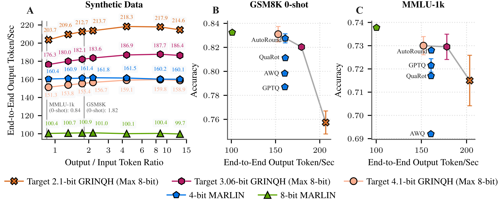

# GRINQH vLLM Plugin

Out-of-tree plugin for the **Gr**aded **In**put-based **Q**uantization **H**ierarchy ([GRINQH](https://arxiv.org/pdf/2606.23419)) quantization method for vLLM.


**Note**: We are working on cleaning up scripts for a smoother quantization workflow, which we aim to push by the 11th.


## Install

```bash
uv pip install -e /path/to/vllm-grinqh-plugin
```

The package registers itself through the `vllm.general_plugins` entry-point
group, so `quantization="grinqh"` becomes available after installation.

## Requirements

GRINQH requires a set of thresholds calibrated for a given model. 
The [replication repository](https://github.com/margo1999/grinqh-replication/) provides scripts to generate them.

Alternatively, GRINQH accepts external thresholds in JSON format, which can be provided as a path using the
`GRINQH_JSON_PATH` env variable.

## Tested versions

We ran all of our experiments for Triton `3.6.0` on a fork of vLLM's `main` @ `0a5cbf633` (2026-06-03, v0.22.1). 
